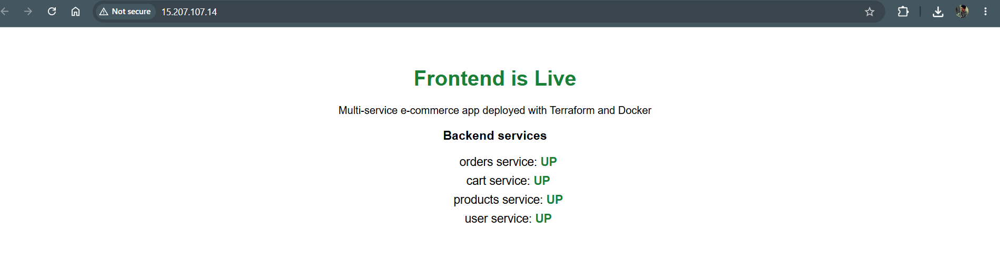

# Multi-Service Node.js E-commerce on AWS (Terraform + Docker)

**Author:** Saurabh Bhatnagar

Four backend services (user, products, orders, cart) and one frontend, containerized with Docker,
published to Docker Hub and deployed on an AWS EC2 instance provisioned entirely with Terraform.

- **Docker Hub:** https://hub.docker.com/repositories/srvbhtngr1
- **Full report with screenshots:** see the [docs](docs/) folder
- **Status:** the AWS resources were destroyed with `terraform destroy` after testing, so there is no live URL. Run the steps below to recreate everything.



## Architecture

```
Internet --> Internet Gateway --> VPC (10.0.0.0/16)
                                   └── Public subnet (10.0.1.0/24)
                                        └── Security group
                                             └── EC2 (Ubuntu 22.04, Docker installed by user-data)
                                                  └── Docker network: ecom-net
                                                       ├── frontend          (80 -> 3000)
                                                       ├── user-service      (3001)
                                                       ├── products-service  (3002)
                                                       ├── orders-service    (3003)
                                                       └── cart-service      (3004)
```

| Service | Container port | Host port | Exposure |
|---|---|---|---|
| frontend | 3000 | 80 | Public |
| user-service | 3001 | 3001 | Internal (security group only) |
| products-service | 3002 | 3002 | Internal |
| orders-service | 3003 | 3003 | Internal |
| cart-service | 3004 | 3004 | Internal |

The frontend shows **"Frontend is Live"** and the live status of all four backends.

## Repository structure

```
.
├── services/            # 4 backends + frontend (server.js, Dockerfile, package.json)
├── terraform/           # providers, variables, main, outputs, user-data template
├── docs/                # Assignment report (Word)
├── screenshots/         # Evidence screenshots (fig01 - fig33)
├── docker-compose.yml   # Local testing
├── build_and_push.sh    # Build, tag and push all images
├── LICENSE
└── README.md
```

## Prerequisites

- Docker
- Terraform 1.5 or later
- AWS CLI, configured with `aws configure` (use an IAM user, not root)
- A Docker Hub account (images must be public)
- An EC2 key pair if you want SSH access (see `key_name` below)

## Usage

### 1. Test locally

```bash
docker compose up --build -d
curl localhost:3001
# open http://localhost:3000
docker compose down
```

### 2. Build and push the images

Make each Docker Hub repository public.

```bash
docker login
chmod +x build_and_push.sh
./build_and_push.sh <dockerhub-username>
```

### 3. Deploy to AWS

```bash
cd terraform
cp terraform.tfvars.example terraform.tfvars    # then edit the values
terraform init
terraform validate
terraform plan
terraform apply
```

`terraform.tfvars` example:

```hcl
dockerhub_username = "<your-dockerhub-username>"
aws_region         = "ap-south-1"
key_name           = "<your-key-pair-name>"      # required for SSH
allowed_ssh_cidr   = "<your-public-ip>/32"       # optional, limits SSH
```

> **Note:** `key_name` must be an existing EC2 key pair in the same region, written without `.pem`.
> If it is left commented out, the instance is created without a key and SSH will fail with `Permission denied (publickey)`.

A full apply creates 7 resources (VPC, internet gateway, subnet, route table, route table association, security group, EC2 instance).

### 4. Open the application

Wait 2-3 minutes after `apply` while the instance installs Docker and pulls the images, then:

```bash
terraform output frontend_url
```

Open the printed URL in a browser.

### 5. Clean up

```bash
terraform destroy
```

## Verification on the instance

```bash
ssh -i ~/.ssh/<key-name>.pem ubuntu@<public-ip>
sudo docker ps
curl localhost:3001
curl localhost:3004/health
sudo tail -n 60 /var/log/user-data.log
```

`docker` needs `sudo` here because the `ubuntu` user is not in the `docker` group.

## Terraform resources

| Resource | Purpose |
|---|---|
| `aws_vpc` | VPC 10.0.0.0/16 |
| `aws_internet_gateway` | Internet access for the VPC |
| `aws_subnet` | Public subnet 10.0.1.0/24 |
| `aws_route_table` + association | Route 0.0.0.0/0 through the internet gateway |
| `aws_security_group` | 80 from anywhere, 22 from a chosen CIDR, 3001-3004 from the group itself |
| `aws_instance` | Ubuntu 22.04 EC2 with user-data that installs Docker and runs the five containers |

## Security notes

- Never commit `*.pem` keys, `terraform.tfstate` or `terraform.tfvars` (all are listed in `.gitignore`).
- Backend ports 3001-3004 are not reachable from the internet, only from inside the security group (verified in `screenshots/fig32-backend-blocked-3001.png`).
- Restrict `allowed_ssh_cidr` to your own IP address.

## Screenshots

All evidence screenshots are in the [screenshots](screenshots/) folder, numbered to match the figures in the report in [docs](docs/).

## License

MIT
